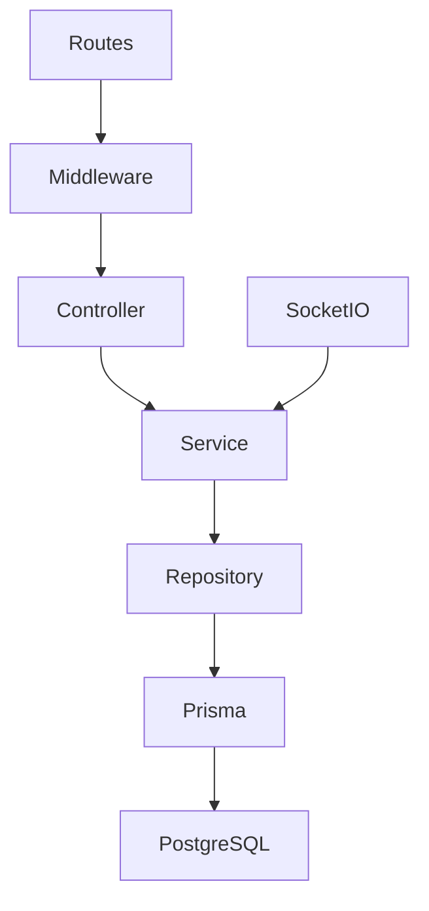

# Kiến trúc BAV-Connect

## Ranh giới ứng dụng

Backend và frontend là hai npm workspace độc lập, dùng chung lockfile và quy tắc định dạng. API REST dùng prefix `/api/v1`. Socket.IO chia sẻ HTTP server với Express và dùng chung cơ chế xác thực JWT.

- **Routes và middleware** định tuyến, kiểm tra origin, xác thực và phân quyền. Express chuyển lỗi async về error handler tập trung.
- **Controller** đọc input bằng schema Zod, gọi service và trả response thống nhất.
- **Service** xử lý xác thực, xuất bản và kiểm duyệt. **Repository** thực hiện truy vấn Prisma, chọn các trường trả ra và gom những thay đổi phải nhất quán vào transaction.
- **Frontend** dùng Server Components cho trang công khai. Client Components phụ trách form, hồ sơ và thao tác quản trị. Trạng thái hiện nằm tại các feature, với hook dùng chung cho dữ liệu từ API.

## Xác thực và quyền truy cập

Đăng ký chuẩn hóa email và hash mật khẩu bằng bcrypt. Đăng nhập cấp JWT 15 phút trong cookie host-only, HttpOnly và SameSite=Lax. Production bật Secure. API kiểm tra origin của request ghi và cho phép CORS có credentials từ origin được cấu hình. Các endpoint đăng nhập và đăng ký có giới hạn tần suất theo IP.

Mỗi lần xác thực, server kiểm tra trạng thái, vai trò và phiên bản phiên từ DB. Logout tăng phiên bản phiên để thu hồi toàn bộ access token hiện có của tài khoản. Socket.IO kiểm tra cookie lúc handshake và xác thực lại khi nhận `session:check`. Vai trò ADMIN được thực thi tại backend trước mọi admin endpoint. Giao diện kiểm tra quyền để điều hướng và hiển thị phù hợp.

Khi triển khai, phục vụ web và API qua HTTPS trên cùng site để cookie SameSite=Lax hoạt động. Ví dụ, dùng các subdomain chung domain gốc. Cấu hình origin và URL API cho từng môi trường. Việc xác minh quyền sở hữu email hoặc tư cách sinh viên cần một luồng xác minh riêng.

## Đối chiếu đề xuất cuộc thi

| Hạng mục  | Định hướng cũ                                                                                    | Quyết định trong repository                                     |
| --------- | ------------------------------------------------------------------------------------------------ | --------------------------------------------------------------- |
| Lưu trữ   | Tệp “Định hướng (2).docx” chọn MySQL/Sequelize. Một bản hồ sơ ICU Code chọn PostgreSQL/Sequelize | PostgreSQL và Prisma theo brief hiện tại                        |
| Nghiệp vụ | Marketplace, đồ thất lạc, ghép nối và kiểm duyệt tự động                                         | Marketplace với luồng duyệt thủ công ở mức khởi tạo             |
| Hạ tầng   | Tài liệu nhóm đề xuất các dịch vụ AWS cho sản phẩm dự thi                                        | Chạy local bằng PostgreSQL và kiểm tra CI bằng PostgreSQL riêng |

Mô tả nhiệm vụ Vòng 2 yêu cầu sản phẩm chạy thật trên AWS, ít nhất ba luồng chính chạy đầu-cuối trên AWS, dữ liệu lưu bền vững và có báo cáo kiểm thử. Các kiểm tra local là bằng chứng cho nền tảng hiện tại. Các hạng mục AWS, demo và kiểm thử tải thuộc giai đoạn triển khai cuộc thi.
